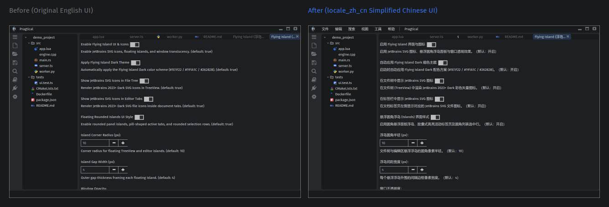
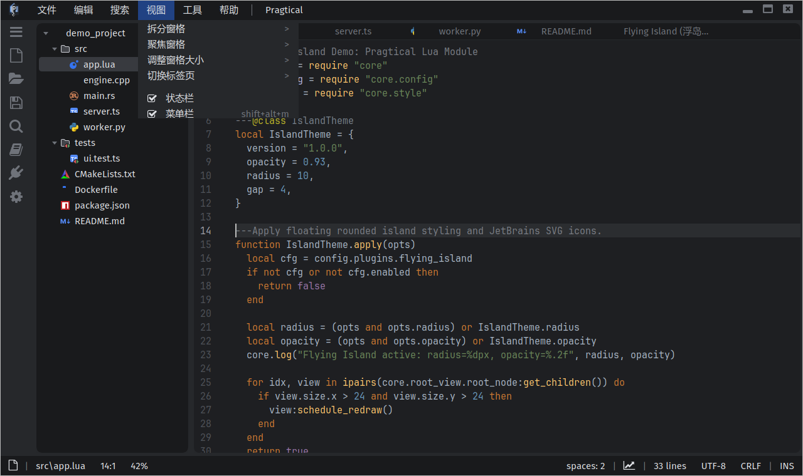

# pragtical-locale-zh-cn

[](https://pragtical.dev/)
[](https://github.com/TongshiWang/pragtical-locale-zh-cn/releases)
[](LICENSE)

> **English Summary**: Simplified Chinese (`zh-CN`) UI localization plugin for [Pragtical](https://pragtical.dev/) (`mod-version: 3`), now officially listed in `pragtical/plugins`. Translates top/context menus, settings panels, dialogs, status bar tooltips, command prompts, and the Plugin Manager without modifying built-in files. Compatible with Windows, Linux, and macOS. Install via PPM: `ppm install locale_zh_cn`.

[Pragtical](https://pragtical.dev/) 文本编辑器的**简体中文界面汉化插件**（`mod-version: 3`），不修改编辑器内置文件，支持 Windows / Linux / macOS 全平台。

<p align="center">
  
</p>

<p align="center">
  
</p>

---

## 功能特性

- **菜单与右键菜单汉化**：覆盖顶层菜单（文件、编辑、搜索、视图、工具、帮助）、子菜单及文件树/编辑器右键上下文菜单，并支持窄窗口下的“菜单”紧凑按钮。
- **设置面板全覆盖**：覆盖 Core 核心设置分组、常用内置插件设置（Treeview、Search UI、Project Search、Line Wrapping、Scale 等）、下拉选项、`Label` 自动折行说明与`（默认：...）`提示。
- **核心界面与弹窗汉化**：覆盖欢迎页（EmptyView）、关于页（AboutView）、日志视图（LogView）、状态栏（StatusView）提示、确认框（NagView）、命令面板（CommandView）提示等，同时保留内部英文标识以确保命令与回调逻辑稳定运行。
- **插件管理器与动态文本**：支持插件列表排序/筛选标签、查找替换匹配计数等动态字符串的模式化翻译。
- **安全开关**：在 **工具 > 设置… > 插件 > 简体中文汉化 (Locale Zh-CN)** 中可随时开启或关闭（重启生效）。

---

## 兼容性

- **Pragtical 版本**：已于 **Pragtical 3.15.0-jit**（`mod-version: 3`）实测通过。
- **操作系统**：Windows 10/11、Linux、macOS 通用。

---

## 安装方法

### 方式一：通过 PPM / 官方插件管理器安装（推荐，全平台适用）

现已正式收录进 Pragtical 官方插件市场！一行命令即可安装：

```sh
ppm install locale_zh_cn
```

- 也可以直接在 Pragtical 中打开 **Tools > Plugin Manager**，搜索 **`locale_zh_cn`** 一键安装。
- *（可选）* 如需跟踪 `main` 分支最新提交，可先执行 `ppm repo add https://github.com/TongshiWang/pragtical-locale-zh-cn.git:main`。

### 方式二：PowerShell 一键安装（Windows）

```powershell
git clone https://github.com/TongshiWang/pragtical-locale-zh-cn.git
cd pragtical-locale-zh-cn
.\install.ps1
```

### 方式三：手动安装

将本仓库中的 `plugins/locale_zh_cn` 文件夹复制到 Pragtical 用户配置目录 `<USERDIR>/plugins/locale_zh_cn`：

- **Windows（安装包自带 `user` 目录）**：`%LOCALAPPDATA%\Programs\Pragtical\user\plugins\locale_zh_cn`
- **Windows（标准配置目录）**：`%USERPROFILE%\.config\pragtical\plugins\locale_zh_cn`
- **Linux / macOS**：`~/.config/pragtical/plugins/locale_zh_cn`

重启 Pragtical 即可生效。

---

## 卸载方法

- **PPM 卸载**：`ppm uninstall locale_zh_cn`
- **Windows 脚本卸载**：在仓库目录运行 `.\uninstall.ps1`
- **临时关闭 / 手动删除**：在 **设置 > 插件 > 简体中文汉化** 中关闭开关，或删除 `<USERDIR>/plugins/locale_zh_cn` 文件夹后重启。

---

## 目录结构

```text
plugins/locale_zh_cn/
├── init.lua           # 插件入口与 UI Hook 逻辑
├── dict_menu.lua      # 菜单与上下文菜单词典
├── dict_ui.lua        # 视图、弹窗与工具提示词典
└── dict_settings.lua  # 设置面板词典
```

## 许可证

[MIT License](LICENSE)
